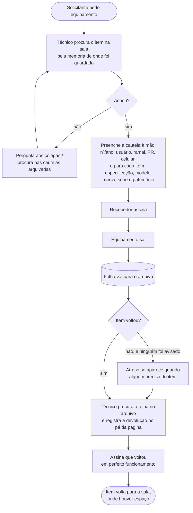

# 2. Processo atual (AS-IS)

Como a saída e a devolução de equipamentos funcionavam **antes do PATRI**:
só com papel e com a memória da equipe.

## Atores

| Ator | Papel no processo |
| --- | --- |
| **Solicitante** | Servidor de outra área que precisa de um equipamento (evento, gravação, empréstimo). |
| **Técnico do setor** | Localiza o item, preenche a cautela, entrega e recebe de volta. |
| **Técnico do transporte** | Leva o equipamento até o destino, quando for o caso. |
| **Chefia** | Responde pelo patrimônio; cobra devoluções e confere o acervo. |
| **Arquivo** | Pasta física onde ficam as cautelas assinadas. |

## Fluxo

## Passo a passo

| # | Passo | Quem | Registro | Observação |
| --- | --- | --- | --- | --- |
| 1 | Pedido do equipamento | Solicitante | Nenhum | O pedido chega ao setor e o atendimento começa na hora. |
| 2 | Localizar o item na sala | Técnico | Nenhum | Depende de quem guardou lembrar onde. Com centenas de itens, quem não guardou precisa procurar armário por armário. |
| 3 | Preencher a cautela | Técnico | Papel | Dados de cada item copiados à mão: 5 campos por equipamento. |
| 4 | Numerar a cautela | Técnico | Papel | Número seguinte ao último usado, controlado à mão. |
| 5 | Assinatura do recebedor | Solicitante | Papel | |
| 6 | Arquivar a folha | Técnico | Arquivo físico | É o único registro de com quem o item está. |
| 7 | Acompanhar o prazo | Ninguém | Nenhum | Não há aviso; o atraso aparece quando o item faz falta. |
| 8 | Receber a devolução | Técnico | Papel (mesma folha) | Precisa achar a folha original no arquivo. |
| 9 | Conferir o estado | Técnico | Frase fixa "perfeito funcionamento" | Não há onde registrar defeito. |
| 10 | Guardar o item | Técnico | Nenhum | O lugar de guarda volta a depender da memória. |

## Informações e onde elas ficavam

| Pergunta | Onde estava a resposta |
| --- | --- |
| Onde está o equipamento X? | Na memória de quem guardou |
| Com quem está? | Em alguma cautela aberta no arquivo |
| Quando volta? | Na cautela, se alguém for procurar |
| O que está atrasado? | Em lugar nenhum — só conferindo folha por folha |
| Em que estado voltou? | Em lugar nenhum |
| Por onde esse item passou no último ano? | Em lugar nenhum |

## Números do processo

| Indicador | Valor |
| --- | --- |
| Equipamentos no acervo | Entre 300 e 1.000 |
| Campos escritos à mão por item na cautela | 5 (especificação, modelo, marca, série, patrimônio) |
| Campos escritos à mão numa cautela de 3 itens | 21 (ver [03](03-problemas.md#esforço-antes-e-depois)) |
| Fontes de informação sobre localização | 1 — a memória da equipe |
| Fontes de informação sobre saídas | 1 — a pasta de cautelas em papel |
