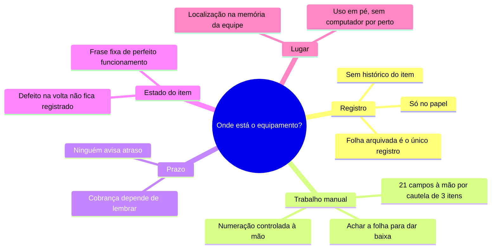

# 3. Problemas e gargalos

O que o mapeamento do [processo atual](02-processo-as-is.md) mostrou.

## Mapa das causas

## Lista de problemas

| ID | Problema | Evidência | Impacto | Gravidade |
| --- | --- | --- | --- | --- |
| P1 | Localização do item depende de quem guardou lembrar | Controle só com papel e memória; acervo de 300 a 1.000 itens | Tempo perdido procurando; item dado como perdido sem estar | Alta |
| P2 | Saber com quem está um item exige procurar no arquivo | A cautela em papel é o único registro da saída | Resposta lenta; risco de não achar | Alta |
| P3 | Dados copiados à mão em toda cautela | 5 campos por item no formulário oficial | Atendimento demorado; erro de cópia no número de patrimônio | Média |
| P4 | Numeração controlada à mão | Formulário oficial | Número repetido ou pulado | Média |
| P5 | Atrasos sem aviso | Não existe registro de prazo fora da folha | Equipamento fica fora sem cobrança; falta no próximo evento | Alta |
| P6 | Estado na devolução não é registrado | Frase fixa "perfeito funcionamento" | Defeito descoberto só no próximo uso, sem saber de onde veio | Média |
| P7 | Não há histórico de cada equipamento | Nada além das folhas soltas | Impossível saber por onde o item passou | Média |
| P8 | Quem atende está em pé, na sala, longe de um computador | Observação da rotina | Qualquer sistema "de mesa" não seria usado | Alta |
| P9 | Item ainda não lançado na base patrimonial oficial fica sem controle nenhum | Itens novos chegam antes do registro oficial | Patrimônio fora do controle | Baixa |

## Gargalo principal

O registro de **onde está** e **com quem está** vivia em dois lugares que não
se consultam rápido: a cabeça da equipe e uma pasta de papel. Todo o resto —
atraso sem cobrança, defeito sem dono, histórico perdido — é consequência
disso.

## Esforço antes e depois

Comparação do trabalho necessário para as tarefas mais comuns, contada a
partir do formulário oficial e das telas do sistema.

### Emitir uma cautela com 3 itens

| | No papel | No PATRI |
| --- | :-: | :-: |
| Número da cautela | 1 campo à mão | automático |
| Dados de quem recebe (nome, ramal, PR, celular) | 4 campos à mão | 1 toque (escolher a pessoa) |
| Dados de cada item (especificação, modelo, marca, série, patrimônio) | 5 × 3 = 15 campos à mão | 3 toques (escolher os itens) |
| Técnico do transporte | 1 campo à mão | 1 campo |
| Motivo e prazo | — | 1 escolha (o motivo sugere o prazo) |
| Emitir e imprimir | — | 1 toque |
| **Total** | **21 campos escritos à mão** | **cerca de 7 ações, nenhum dado copiado** |

### Outras tarefas

| Tarefa | No papel | No PATRI |
| --- | --- | --- |
| Responder "onde está o item X?" | Lembrar ou procurar armário por armário | Digitar parte do nome; a ficha mostra Sala → Armário → Prateleira |
| Responder "com quem está o item X?" | Procurar entre as cautelas abertas no arquivo | Mesma busca; a ficha mostra o responsável e o prazo |
| Listar o que está atrasado | Conferir folha por folha | Aparece sozinho na tela inicial e em Cautelas |
| Registrar uma devolução | Achar a folha no arquivo e escrever no pé | Abrir a cautela pelo número e tocar em Devolver |
| Saber se um item voltou com defeito | Impossível | Estado físico de cada item fica gravado; itens ruins aparecem em Atenção |
