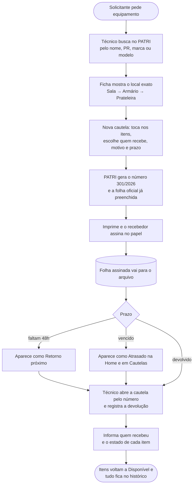

# 4. Processo proposto (TO-BE)

Como a saída e a devolução funcionam **com o PATRI**. O que não mudou foi
mantido de propósito: a cautela continua sendo o documento oficial e as
assinaturas continuam no papel (decisões D1 e D2, em
[01-imersao.md](01-imersao.md#decisões-da-chefia)).

## Fluxo

## O que muda em cada passo

| Passo | Antes (AS-IS) | Depois (TO-BE) | Problema resolvido |
| --- | --- | --- | --- |
| Localizar o item | Memória da equipe | Busca tolerante: `vostro`, `dell` ou `armário a` encontram o item; a ficha mostra o caminho do local | P1 |
| Saber com quem está | Procurar no arquivo | Ficha do item mostra responsável, cautela e prazo; tela Cautelas lista as abertas | P2 |
| Preencher a cautela | Copiar à mão os dados de cada item | Tocar nos itens; o sistema preenche especificação, marca, modelo, série e patrimônio | P3 |
| Numerar | À mão | Automático, número/ano, único, recomeça a cada ano | P4 |
| Acompanhar prazo | Ninguém avisa | Condições Retorno próximo e Atrasado calculadas na hora | P5 |
| Registrar a devolução | Frase fixa | Estado físico de cada item (ótimo a danificado) e quem recebeu | P6 |
| Consultar o passado | Não existe | Histórico do item, das pessoas e auditoria de cadastros | P7 |
| Onde se usa | Mesa + papel | Tablet e celular, instalável como app, alvos de toque de 44px | P8 |
| Item fora da base oficial | Sem controle | Cadastrado normalmente com a marca "Não importado" | P9 |

## Inovação

- **Papel e sistema convivendo.** Em vez de tentar substituir a assinatura —
  o que a chefia não queria —, o sistema gera a folha oficial idêntica ao
  formulário e guarda o número para achar o papel. A mudança na rotina é
  mínima e o ganho está no que antes era trabalho manual.
- **Situação × condição.** A situação do item (Disponível, Fora da sala, Em
  manutenção, Baixado) é gravada; atrasos e avisos são calculados na leitura.
  Não existe rotina que alguém precise lembrar de rodar.
- **Locais em árvore livre.** O próprio setor monta a estrutura real (prédio,
  sala, armário, prateleira, gaveta), quantos níveis precisar.
- **Funciona sem internet.** Roda num notebook do setor e atende tablets e
  celulares pela rede Wi-Fi interna.

## Viabilidade

| Aspecto | Situação |
| --- | --- |
| **Custo de software** | Zero: React, Node.js, Express, Prisma e PostgreSQL são livres. |
| **Infraestrutura** | Um notebook dedicado como servidor e a rede Wi-Fi que o setor já tem. Nenhuma compra necessária. |
| **Implantação** | Instalador de dois cliques ([guia](../SERVIDOR-LOCAL.md)); início automático com o Windows. |
| **Segurança dos dados** | Backup automático diário; exclusão lógica com lixeira; nenhum comando comum apaga dados. |
| **Treinamento** | Interface em português direto, sem termos técnicos, com os mesmos nomes usados na sala (cautela, PR, armário, prateleira); a equipe aprende usando, sem curso. |
| **Manutenção** | O aluno mantém o sistema enquanto atua no setor. Código, regras de negócio, instalação, backup e restauração estão documentados no repositório, para que outra pessoa possa assumir. |
| **Validade jurídica** | Inalterada: o documento assinado continua sendo o papel. |
