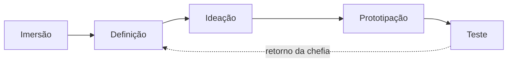

# 5. Design Thinking

Como o projeto passou pelas cinco etapas — e onde cada uma deixou rastro.

| Etapa | O que foi feito | Onde está |
| --- | --- | --- |
| Imersão | Observação na sala, leitura do formulário oficial, conversas com a chefia | [01-imersao.md](01-imersao.md) |
| Definição | Processo atual, problemas, persona, ponto de vista | [02](02-processo-as-is.md), [03](03-problemas.md), abaixo |
| Ideação | Ideias levantadas e o destino de cada uma; alternativas de solução | abaixo |
| Prototipação | Protótipo visual, depois sistema funcional em incrementos | [08](08-scrum-e-backlog.md), [09](09-prototipo.md) |
| Teste | Cada versão mostrada à chefia; folha impressa comparada com o formulário oficial; testes ponta a ponta durante o desenvolvimento | [08](08-scrum-e-backlog.md) |

---

## Personas

As personas resumem o que foi observado na imersão.

### Técnico — "Rafael"

| | |
| --- | --- |
| **Quem é** | Técnico de áudio e vídeo do setor, terceirizado, 30 e poucos anos. |
| **Onde trabalha** | Em pé, na sala de equipamentos, com o celular no bolso e cabos na mão. |
| **O que quer** | Achar o item, entregar e voltar para o evento. |
| **O que atrapalha** | Ter que procurar a câmera em três armários; preencher cautela à mão com fila esperando. |
| **Frase** | "Eu sei que está aqui em algum lugar." |

### Chefia — "Cláudia"

| | |
| --- | --- |
| **Quem é** | Responsável pelo setor e pelo patrimônio. |
| **Onde trabalha** | Na mesa, entre reuniões. |
| **O que quer** | Saber o que está fora, com quem e desde quando, sem ter que perguntar. |
| **O que atrapalha** | Descobrir um atraso só quando o próximo evento precisa do equipamento. |
| **Frase** | "Quem assinou essa cautela?" |

## Mapa de empatia — técnico

| | |
| --- | --- |
| **Pensa e sente** | Medo de entregar o item errado ou de não achar na hora; incômodo com papelada repetida. |
| **Vê** | Armários cheios, etiquetas de patrimônio, uma pilha de cautelas. |
| **Ouve** | "Cadê o microfone sem fio?" "Isso já voltou?" |
| **Fala e faz** | Procura, pergunta aos colegas, copia dados para o papel. |
| **Dores** | Tempo perdido procurando; cobrança de atraso que não é dele; defeito herdado sem saber de quem. |
| **Ganhos** | Achar no primeiro lugar que olhar; cautela pronta em segundos; saber o que está atrasado sem procurar. |

## Ponto de vista

> **Técnicos do setor precisam saber em segundos onde está um equipamento e
> com quem ele está, porque hoje essa informação está dividida entre a memória
> da equipe e uma pasta de papel, e quem atende está em pé, longe de um
> computador.**

## Como poderíamos…

- …mostrar o local de um item sem que ninguém precise lembrar?
- …emitir a cautela sem copiar dado que o patrimônio já tem?
- …avisar do atraso sem ninguém ter que conferir a pasta?
- …manter o papel assinado e, ainda assim, achar tudo pelo sistema?
- …fazer isso funcionar no celular, sem depender da internet?

---

## Ideação — o que foi pensado e o que aconteceu com cada ideia

| Ideia | Destino | Motivo |
| --- | --- | --- |
| Busca única que entende nome, PR, marca, modelo, local e responsável | **Adotada** | Responde direto a pergunta principal. |
| Locais em árvore livre, criados pelo próprio setor | **Adotada** | Os armários e prateleiras reais não cabem em três níveis fixos. |
| Cautela com vários itens, gerando a folha oficial | **Adotada** | Espelha o processo real; elimina a cópia à mão. |
| Separar Pessoa (quem pega) de Usuário (quem faz login) | **Adotada** | Quem pega equipamento quase nunca usa o sistema. |
| Registrar o estado de cada item na devolução | **Adotada** | Resolve a frase fixa "perfeito funcionamento". |
| Instalar como app no tablet e no celular | **Adotada** | Uso em pé, na sala. |
| Assinatura na tela do tablet | **Descartada** | Decisão da chefia: assinatura fica no papel. |
| Anexar foto do papel assinado | **Descartada** | O papel arquivado já é o documento; o sistema guarda o número para achá-lo. |
| Devolução parcial, item por item | **Descartada** | Chefia definiu prazo único e devolução da cautela inteira. |
| Numeração sequencial sem ano | **Substituída** | Chefia pediu número/ano, começando em 300. |
| QR Code nas etiquetas | **Descartada** | Exigiria etiquetar o acervo inteiro; a busca já resolve. |
| Painel com gráficos | **Descartada** | Não ajuda a achar item; a tela inicial é a busca. |
| Hospedar na nuvem gratuita | **Substituída** | Banco gratuito expira; trocado por servidor local na rede interna. |

## Alternativas de solução

| | A1 — Continuar no papel com uma planilha | A2 — Sistema genérico de inventário pronto (ex.: GLPI, Snipe-IT) | A3 — Sistema próprio (PATRI) |
| --- | --- | --- | --- |
| **Ideia** | Planilha compartilhada com local e responsável | Instalar e configurar um sistema de mercado de código aberto | Desenvolver um sistema sob medida para o processo do setor |
| **Folha oficial da cautela** | Continua à mão | Exige personalização | Gerada idêntica ao formulário |
| **Uso no celular em pé** | Ruim | Médio | Feito para isso |
| **Sem internet** | Depende de onde está a planilha | Possível, com servidor próprio | Sim, servidor na rede interna |
| **Custo** | Zero | Zero de licença; configuração e servidor | Zero de licença; tempo de desenvolvimento |
| **Esforço** | Baixo | Médio | Alto |

### Matriz de decisão

Notas de 1 (pior) a 5 (melhor). Peso de 1 a 3.

Os pesos refletem o que a imersão mostrou como mais importante: aderência ao
processo e uso em pé no tablet valem o triplo do esforço de implantação.

| Critério | Peso | A1 | A2 | A3 |
| --- | :-: | :-: | :-: | :-: |
| Aderência ao processo e à folha oficial | 3 | 2 | 3 | 5 |
| Facilidade de uso no tablet e celular | 3 | 1 | 3 | 5 |
| Funcionamento sem internet | 2 | 3 | 4 | 5 |
| Custo | 2 | 5 | 4 | 4 |
| Esforço de implantação | 1 | 5 | 3 | 2 |
| Inovação e criatividade | 2 | 1 | 2 | 5 |
| **Total ponderado** (máx. 65) | | **32** | **41** | **60** |

**Escolha: A3 — sistema próprio.** Custa mais esforço, mas é a única
alternativa que imprime a cautela oficial pronta, funciona bem em pé no
celular e roda sem internet — exatamente os pontos em que o processo atual
falha.
