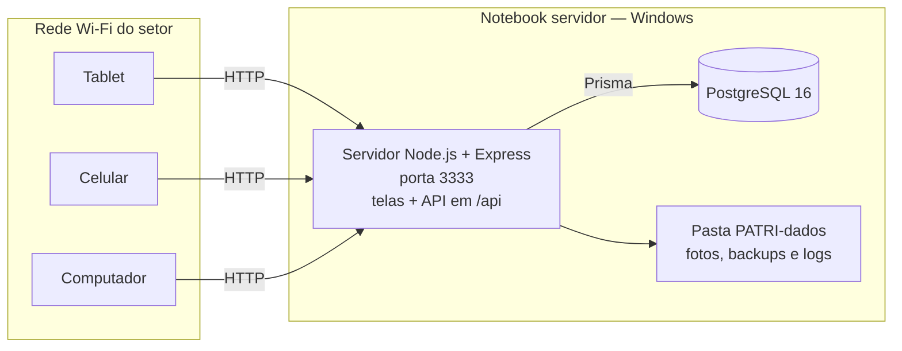
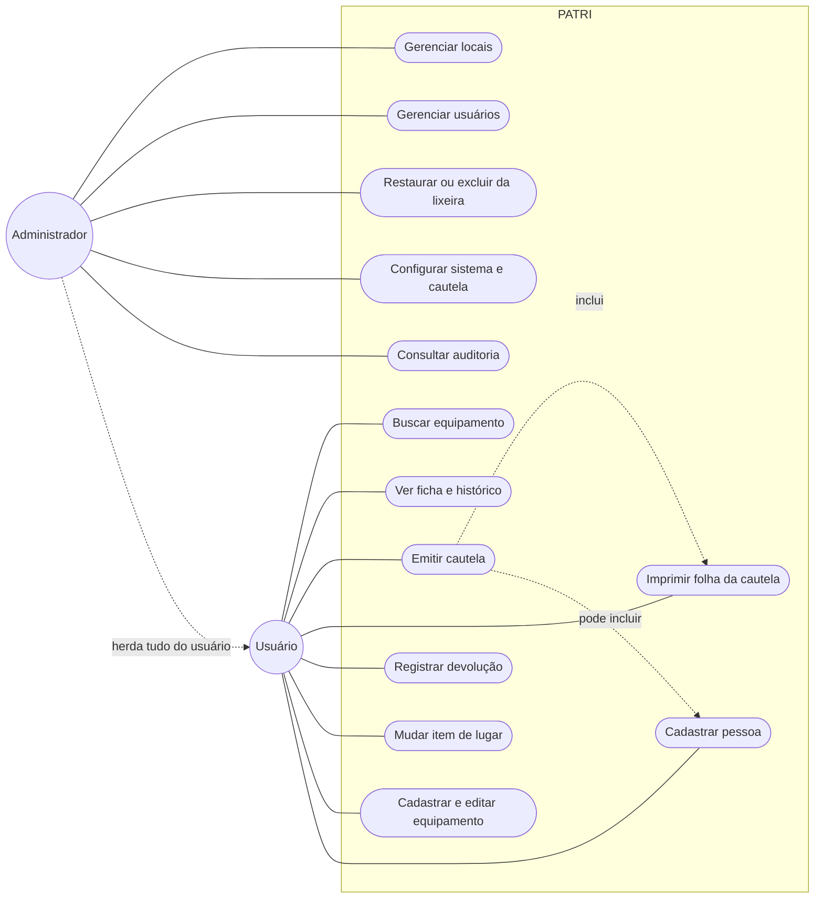
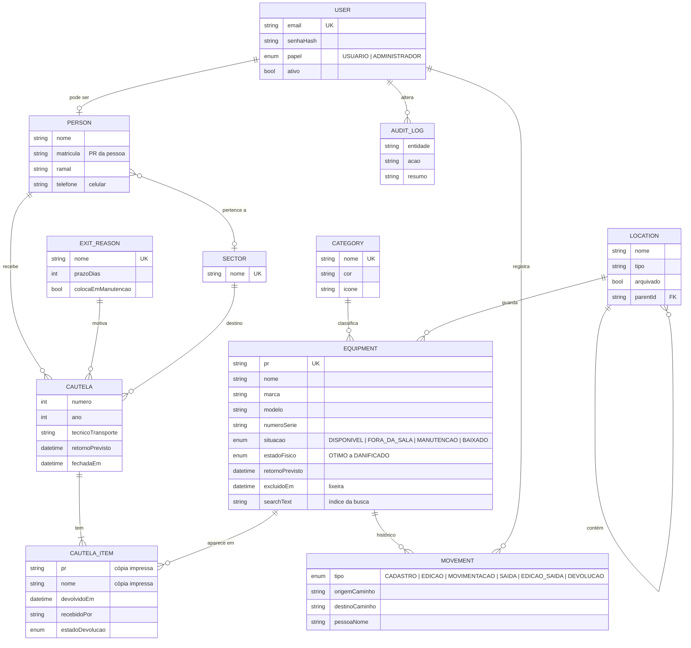
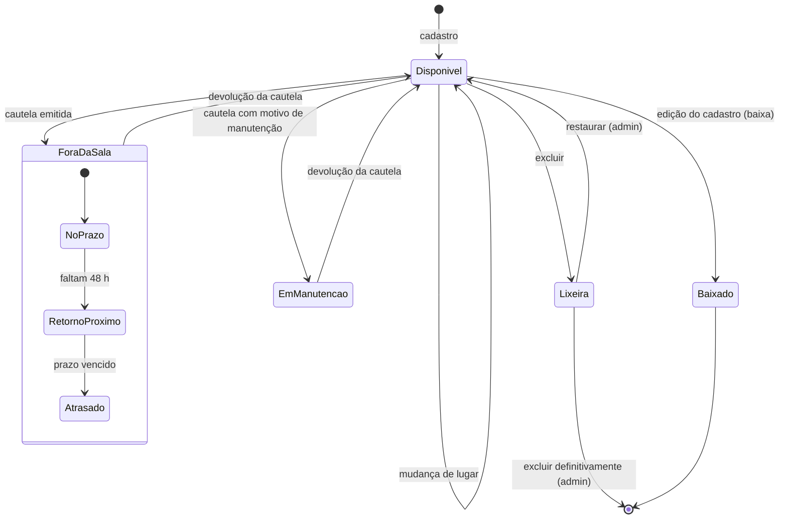
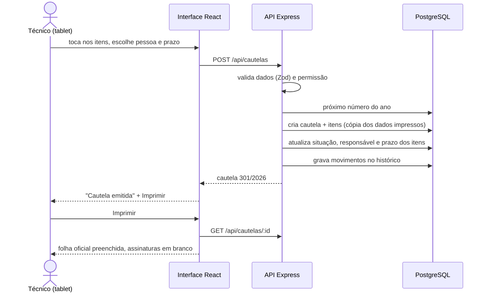

# 7. Projeto do sistema

Arquitetura, casos de uso, modelo de dados e comportamento da cautela. Tudo
aqui corresponde ao código deste repositório (`server/prisma/schema.prisma` e
`server/src/routes/`).

## Arquitetura

| Camada | Tecnologia | Por quê |
| --- | --- | --- |
| Interface | React 19 + TypeScript + Vite, PWA | Componentes reutilizáveis; instalável no tablet e no celular |
| API | Node.js 20 + Express + Zod | Leve, mesma linguagem do frontend; toda entrada validada |
| Acesso a dados | Prisma | Esquema tipado e versionado no repositório |
| Banco | PostgreSQL 16 | Relacional, livre, robusto para histórico e auditoria |
| Autenticação | JWT + bcrypt | Sessão sem estado no servidor; senha com hash |
| Implantação | Notebook Windows na rede interna | Funciona sem internet; custo zero |

---

## Casos de uso

### UC3 — Emitir cautela

| | |
| --- | --- |
| **Ator** | Usuário |
| **Pré-condição** | Usuário autenticado; itens com situação Disponível. |
| **Fluxo principal** | 1. Usuário abre **Nova cautela**. 2. Busca e toca nos itens. 3. Escolhe a pessoa que recebe. 4. Informa destino, motivo, técnico do transporte e prazo (o motivo sugere o prazo padrão). 5. Confirma. 6. O sistema gera o número/ano, muda os itens para Fora da sala (ou Em manutenção, se o motivo pedir) e registra no histórico. 7. O sistema oferece a impressão da folha. |
| **Fluxo alternativo** | 3a. A pessoa não está cadastrada: usuário cadastra ali mesmo e continua. |
| **Exceções** | Algum item não está mais disponível: o sistema recusa e informa o nome e o PR do item. Item excluído nesse meio-tempo: o sistema avisa e não emite. |
| **Pós-condição** | Cautela aberta; itens com responsável e prazo. |
| **Regras** | RN01–RN07, RN13, RN17 |

### UC5 — Registrar devolução

| | |
| --- | --- |
| **Ator** | Usuário |
| **Pré-condição** | Cautela aberta. |
| **Fluxo principal** | 1. Usuário abre a cautela (pela lista ou pelo número). 2. Toca em **Devolver**. 3. Informa quem recebeu e, se preciso, o estado físico de cada item. 4. Confirma. 5. O sistema encerra a cautela, devolve os itens para Disponível no local de guarda e registra no histórico. |
| **Pós-condição** | Cautela encerrada; reimpressão já mostra a data da devolução. |
| **Regras** | RN03, RN12 |

---

## Modelo de dados

Entidades principais (campos resumidos).

Restrições importantes: `(ano, numero)` é único em `CAUTELA`; `pr` é único em
`EQUIPMENT`; `MOVEMENT` guarda cópias em texto (caminho do local, nome da
pessoa) para o histórico sobreviver a renomeações e exclusões.

---

## Ciclo de vida do equipamento

As condições dentro de *Fora da sala* (no prazo, retorno próximo, atrasado)
não são gravadas: o sistema calcula na hora em que alguém consulta (RN11).

## Sequência — emitir cautela

