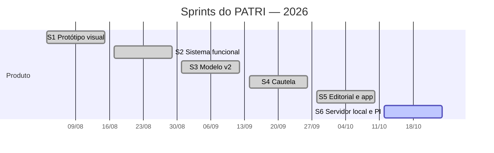

# 8. Scrum e backlog

O projeto foi conduzido com Scrum em sprints de **duas semanas**, de agosto a
outubro de 2026, com a chefia do setor validando cada incremento.

## Papéis

Projeto individual: o aluno acumula os três papéis do Scrum, e a chefia
participa como cliente — prática comum em equipes de uma pessoa, em que o
importante é manter os eventos e a validação com quem usa.

| Papel | Quem | Responsabilidade no projeto |
| --- | --- | --- |
| **Product Owner** | Henrique Augusto | Traduz as necessidades do setor em histórias e ordena o backlog. |
| **Scrum Master** | Henrique Augusto | Mantém o ritmo das sprints, os eventos e remove impedimentos (ex.: hospedagem que expirava). |
| **Developer** | Henrique Augusto | Projeta, codifica, testa e implanta os incrementos. |
| **Cliente / stakeholder** | Chefia do Serviço de Áudio e Vídeo | Define as regras do processo e aprova cada entrega na review. |
| **Usuários** | Técnicos do setor | Usam o sistema e dão retorno no dia a dia. |

## Eventos

| Evento | Como acontece | Frequência |
| --- | --- | --- |
| **Sprint** | Duas semanas, com um objetivo único | Contínua |
| **Planning** | Escolher do backlog as histórias que cumprem o objetivo da sprint | Início da sprint |
| **Daily** | Planejamento rápido do dia: o que foi feito, o que vem, o que trava | Dias de trabalho no projeto |
| **Review** | Sistema mostrado funcionando para a chefia; o retorno vira item no backlog | Fim da sprint |
| **Retrospectiva** | O que manter, o que melhorar, uma ação concreta | Fim da sprint |
| **Acompanhamento com o professor** | Andamento e dúvidas do projeto | Semanal |

## Definição de pronto

Uma história só está pronta quando:

- faz o que os critérios de aceite pedem, no tablet e no celular;
- tem os estados de carregando, vazio e erro;
- respeita as regras de negócio de [06-requisitos.md](06-requisitos.md);
- foi vista funcionando pela chefia (para mudança de regra ou de fluxo);
- está no GitHub;
- não apaga nem altera dado existente sem backup e aviso.

---

## Sprints

Cronograma das sprints a partir do início do projeto, em agosto de 2026.

### Sprint 1 — Protótipo visual (03/08 a 14/08)

**Objetivo:** mostrar à chefia como seria achar um equipamento no tablet,
antes de construir o sistema.

| Entregue | Histórias |
| --- | --- |
| Especificação de design e regras de interface; design system com tokens; telas navegáveis (início, busca, ficha, movimentação) com dados de exemplo | US01, US02 (interface) |

**Review:** telas mostradas à chefia; direção aprovada para seguir com o
sistema de verdade, com a busca como tela principal.
**Retrospectiva:** começar pelas telas evitou construir funcionalidade que a
chefia não queria. *Ação:* manter o protótipo como referência obrigatória
(`docs/PATRI-design.md`).

### Sprint 2 — Sistema funcional (17/08 a 28/08)

**Objetivo:** os dados deixam de ser de exemplo e passam a ficar guardados.

| Entregue | Histórias |
| --- | --- |
| API em Node.js, Express e Prisma; banco PostgreSQL; login; cadastro de equipamentos; busca tolerante; mudança de lugar; histórico; lixeira | US01, US02, US10, US11, US14 |

**Review:** busca e cadastro em uso de teste; ficou claro que as saídas
precisavam seguir a cautela oficial em papel, e não um registro avulso por
item.
**Retrospectiva:** níveis fixos de local (sala → armário → prateleira) não
representavam a sala real. *Ação:* modelar locais como árvore livre na sprint
seguinte.

### Sprint 3 — Modelo v2 (31/08 a 11/09)

**Objetivo:** o sistema reflete a estrutura e as pessoas reais do setor.

| Entregue | Histórias |
| --- | --- |
| Locais em árvore livre com criação em série e arquivamento; Pessoa separada de Usuário; categorias, setores e motivos de saída como cadastros | US03 |

**Review:** a chefia forneceu o formulário oficial de cautela para servir de
modelo e definiu que as assinaturas continuam no papel (D1).
**Retrospectiva:** separar Pessoa de Usuário resolveu o caso de quem pega
equipamento sem ter login. *Ação:* ler o formulário campo a campo antes de
modelar a cautela.

### Sprint 4 — Cautela (14/09 a 25/09)

**Objetivo:** toda saída vira uma cautela igual à folha oficial.

| Entregue | Histórias |
| --- | --- |
| Cautela com vários itens; folha de impressão idêntica ao formulário; tela Cautelas; condições Atrasado e Retorno próximo; devolução com estado de cada item; cadastro de pessoa durante a emissão; permissões só para o administrador | US04, US05, US06, US07, US08, US09, US12 |

**Review:** a chefia redefiniu três regras — numeração número/ano a partir de
300 (D3), prazo único e devolução da cautela inteira em vez de item por item
(D4), e a posição dos dados na folha (D5). Tudo ajustado dentro da sprint.
**Retrospectiva:** a devolução parcial foi construída e depois retirada.
*Ação:* confirmar regras com a chefia, com um exemplo concreto, **antes** de
codificar.

### Sprint 5 — Direção Editorial e app (28/09 a 09/10)

**Objetivo:** deixar o sistema pronto para uso diário no tablet.

| Entregue | Histórias |
| --- | --- |
| Direção visual Editorial (tema claro, animações desligáveis); instalação como app (PWA); correções de usabilidade; publicação na nuvem; preparação do servidor local (commit de 05/10) | US13 |

**Review:** sistema em uso pela equipe; surgiu o risco de o banco gratuito da
nuvem expirar em 30 dias.
**Retrospectiva:** depender de serviço gratuito externo é frágil para uso
diário. *Ação:* migrar para servidor na rede interna.

### Sprint 6 — Servidor local e documentação (12/10 a 23/10) — em andamento

**Objetivo:** o sistema roda no setor sem internet, e o processo fica
documentado para a disciplina.

| Entregue | Histórias |
| --- | --- |
| Notebook como servidor na rede Wi-Fi; início automático; backup diário; migração dos dados; documentação do Projeto Integrador; backlog no GitHub | US15, US16 |

**Retrospectiva:** o repositório só recebeu o sistema pronto, num único
commit. *Ação:* a partir daqui, cada mudança entra por issue e commit no
GitHub, para o histórico ficar visível.

---

## Product backlog

### Histórias entregues

| ID | Como… | quero… | para… | Critério de aceite | Sprint |
| --- | --- | --- | --- | --- | :-: |
| US01 | técnico | buscar um equipamento por qualquer parte do nome, PR, marca ou modelo | achar em segundos | `vostro` encontra "Notebook Dell Vostro 5470"; sem diferença de acento | S1–S2 |
| US02 | técnico | ver o caminho exato do local na ficha | ir direto ao armário certo | Ficha mostra Sala → Armário → Prateleira | S1–S2 |
| US03 | administrador | montar a árvore de locais como ela é | o sistema refletir a sala real | Níveis livres; nome repetido no mesmo nível é recusado | S3 |
| US04 | técnico | emitir uma cautela tocando nos itens | não copiar dados à mão | Itens escolhidos saem na folha com marca, modelo, série e PR | S4 |
| US05 | chefia | que a cautela tenha número/ano automático | achar a folha no arquivo | 300/2026 no primeiro ano; recomeça em 1 no ano seguinte | S4 |
| US06 | técnico | imprimir a folha oficial preenchida | só colher a assinatura | Folha idêntica ao formulário; assinaturas em branco | S4 |
| US07 | técnico | cadastrar quem recebe sem sair da cautela | não perder o atendimento | Pessoa criada e já selecionada | S4 |
| US08 | técnico | registrar a devolução e o estado de cada item | saber o que voltou com defeito | Cautela encerra; itens Ruim/Danificado ficam em Atenção | S4 |
| US09 | chefia | ver o que está atrasado ou perto de vencer | cobrar a tempo | Atrasado e Retorno próximo destacados na Home e em Cautelas | S4 |
| US10 | técnico | mudar um item de prateleira sem emitir cautela | manter o local certo | Histórico registra origem e destino | S2 |
| US11 | técnico | ver o histórico de um equipamento | saber por onde ele passou | Linha do tempo por dia, com quem, o quê e onde | S2 |
| US12 | administrador | gerenciar usuários e senhas | controlar o acesso | Usuário comum não vê nem altera dados de conta | S4 |
| US13 | técnico | instalar o PATRI no celular | abrir como app, em tela cheia | Ícone na tela inicial no Android e no iOS | S5 |
| US14 | técnico | recuperar um item excluído por engano | não perder o cadastro | Lixeira; administrador restaura | S2 |
| US15 | chefia | que o sistema funcione sem internet | usar todo dia sem depender de ninguém | Acesso pelo IP do notebook na rede Wi-Fi | S6 |
| US16 | chefia | backup automático | não perder dados se o notebook falhar | Uma cópia por dia; restauração documentada | S6 |

### Próximos itens

Itens técnicos e de disciplina entram na próxima sprint. Ideias de produto
**só entram com aprovação da chefia**.

| ID | Item | Tipo | Prioridade |
| --- | --- | --- | :-: |
| PB01 | Coletar a avaliação da chefia (formulário de [10](10-avaliacao-comunidade.md)) | Disciplina | Alta |
| PB02 | Cópia do backup diário fora do notebook (pen drive ou rede do órgão) | Técnico | Alta |
| PB03 | Guardar no repositório os testes ponta a ponta usados no desenvolvimento | Técnico | Média |
| PB04 | Verificação automática a cada envio ao GitHub (compilar frontend e servidor), sem publicação automática | Técnico | Média |
| PB05 | Senha provisória com troca obrigatória no primeiro acesso | Ideia — decisão da chefia | Baixa |
| PB06 | Modo de conferência de inventário por local | Ideia — decisão da chefia | Baixa |
| PB07 | Relatório de cautelas por período | Ideia — decisão da chefia | Baixa |

## Backlog no GitHub

O backlog fica na aba **Issues** do repositório, criado pelo script
[`criar-issues.sh`](criar-issues.sh): as histórias entregues aparecem fechadas
(registro retroativo) e os próximos itens, abertos. O quadro em **Projects**
organiza tudo em *Backlog · A fazer · Fazendo · Revisão · Pronto*, com um
milestone por sprint. Commits citam a issue (`Closes #14`).
