# 9. Protótipo funcional

O protótipo deste projeto é o **próprio sistema em uso no setor**. As telas
abaixo foram capturadas numa cópia de demonstração, com pessoas e
equipamentos fictícios, para não expor dados reais. A maioria está no tamanho
de celular, que é onde o sistema é mais usado.

| # | Tela | Requisitos |
| --- | --- | --- |
| 1 | [Login](#1-login) | RF01 |
| 2 | [Busca](#2-busca) | RF04, RF05 |
| 3 | [Ficha do equipamento](#3-ficha-do-equipamento) | RF06 |
| 4 | [Locais](#4-locais) | RF13–RF16 |
| 5 | [Nova cautela](#5-nova-cautela) | RF17, RF18, RF20 |
| 6 | [Folha impressa](#6-folha-impressa) | RF19, RF25 |
| 7 | [Cautelas](#7-cautelas) | RF23, RF24 |
| 8 | [Cautela devolvida](#8-cautela-devolvida) | RF22 |
| 9 | [Histórico](#9-histórico) | RF30 |
| 10 | [Cadastros](#10-cadastros) | RF26, RF27 |
| 11 | [Configurações da cautela](#11-configurações-da-cautela) | RF28 |
| 12 | [Celular e computador](#12-celular-e-computador) | RNF01 |

---

### 1. Login

Entrada com e-mail e senha. Contas são criadas só pelo administrador.

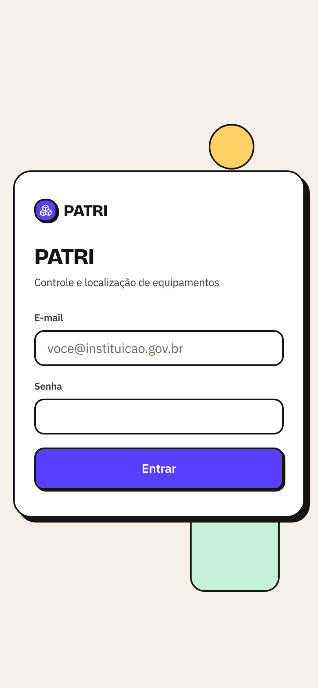

### 2. Busca

Basta parte do nome: `sennheiser` encontra os dois microfones. Cada cartão
mostra a situação (Disponível, Fora da sala) e as condições calculadas
(Retorno próximo, Atenção).

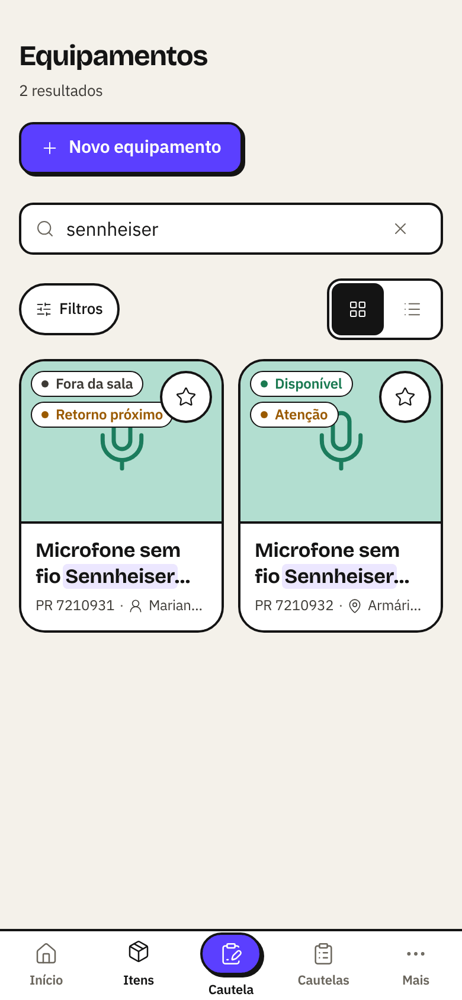

### 3. Ficha do equipamento

Responde as duas perguntas do sistema: onde fica guardado e, se saiu, em qual
cautela está e quando volta.

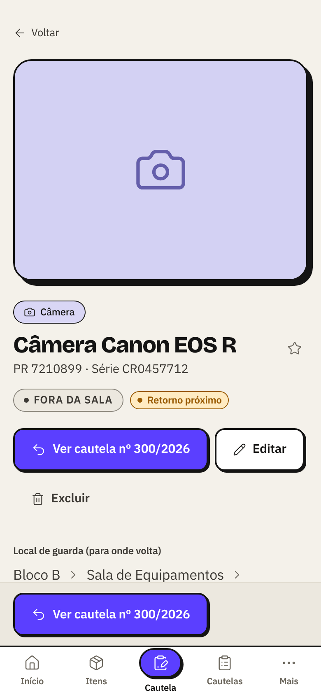

### 4. Locais

A estrutura real da sala, em árvore livre: prédio → sala → armário →
prateleira. Ao escolher um local, aparecem os equipamentos guardados nele.

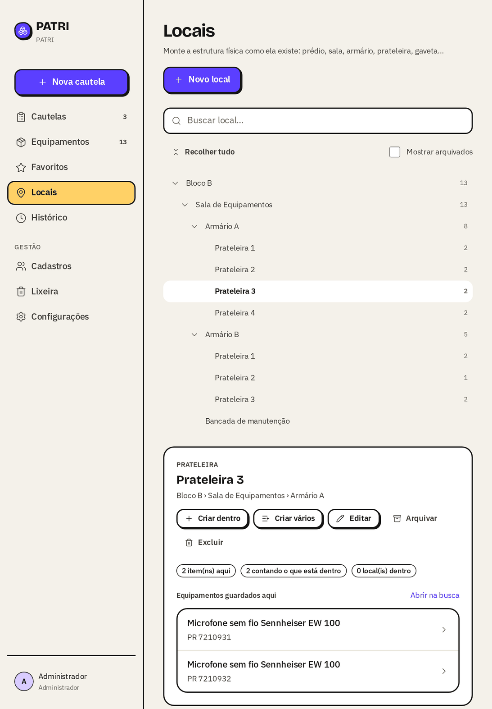

### 5. Nova cautela

O número já vem reservado (número/ano). O técnico adiciona os itens por
toque e escolhe quem recebe.

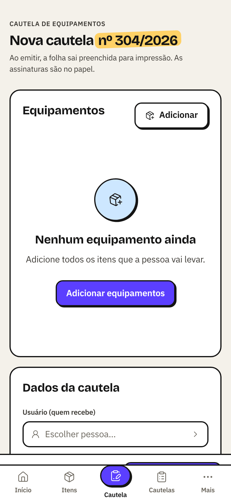

### 6. Folha impressa

A folha segue o formulário oficial: cabeçalho, brasão, dados do usuário nas
posições definidas pela chefia, tabela de itens preenchida e as linhas de
assinatura em branco.

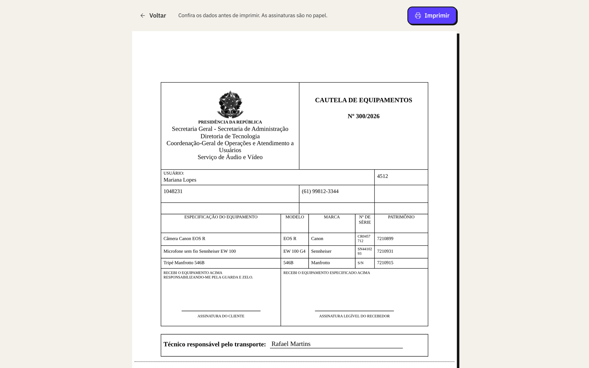

### 7. Cautelas

Cautelas abertas, com as atrasadas e as que vencem em breve destacadas.

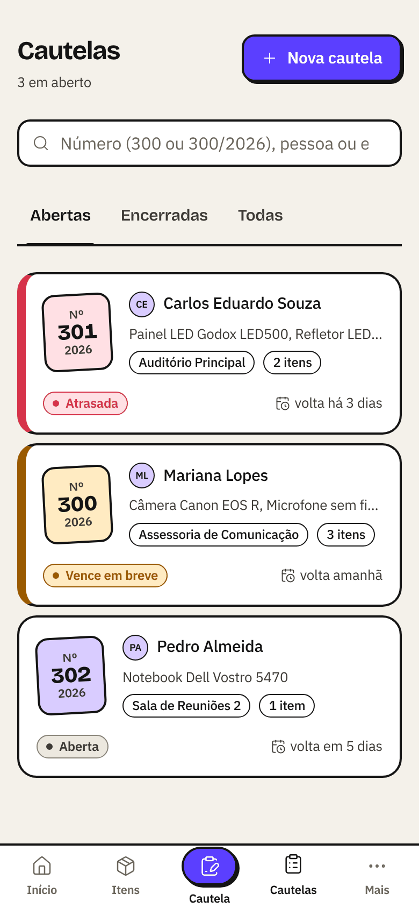

### 8. Cautela devolvida

Depois da devolução a cautela fica encerrada, com quem recebeu e o estado de
cada item. O microfone voltou danificado e passou a aparecer em Atenção.

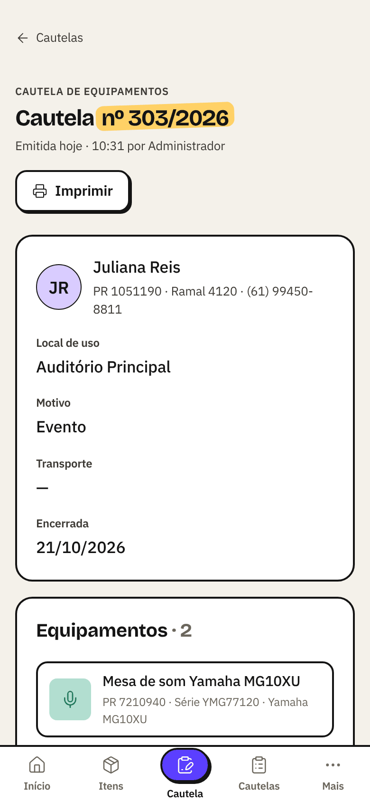

### 9. Histórico

Linha do tempo de tudo que aconteceu, agrupada por dia, com filtros por
equipamento, pessoa, tipo e período.

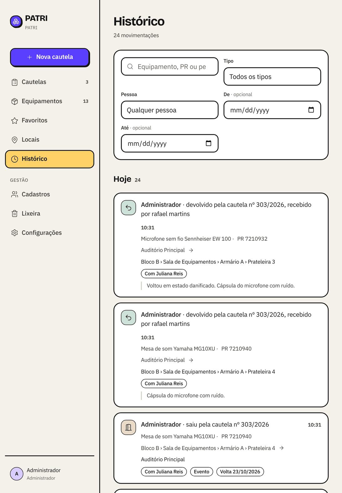

### 10. Cadastros

Pessoas (quem pode receber equipamento, sem precisar de login), setores,
categorias, motivos de saída e usuários.

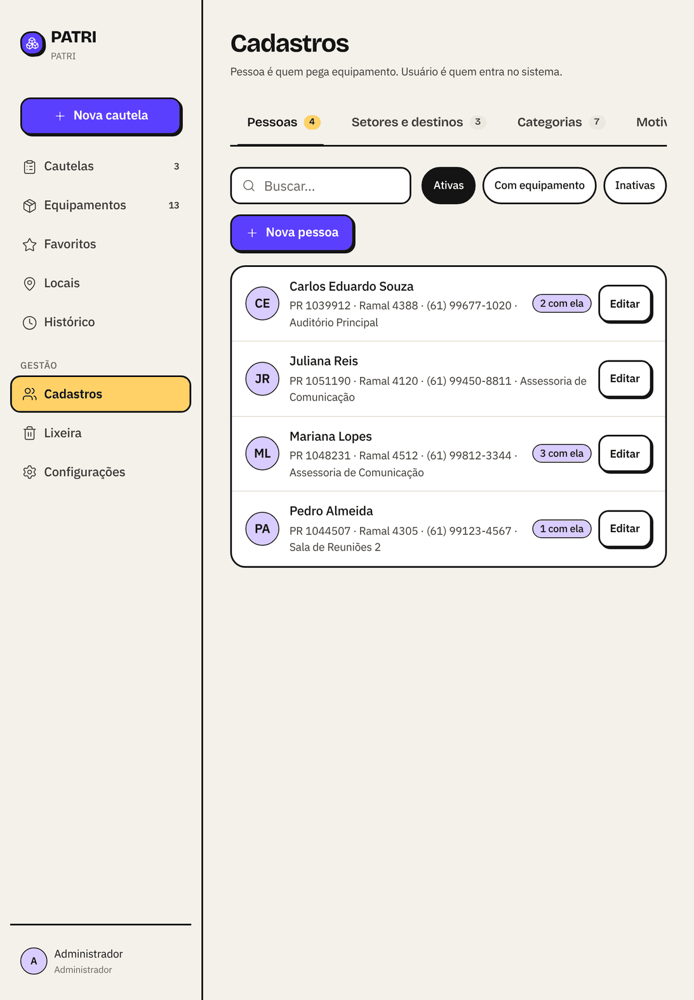

### 11. Configurações da cautela

O cabeçalho impresso, a cidade, o número inicial (300) e o ano em que ele vale.

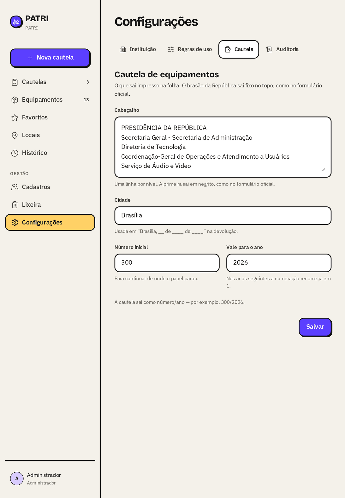

### 12. Celular e computador

A mesma tela inicial nos dois tamanhos. No celular a barra lateral vira
navegação inferior, com **Cautela** como ação central.

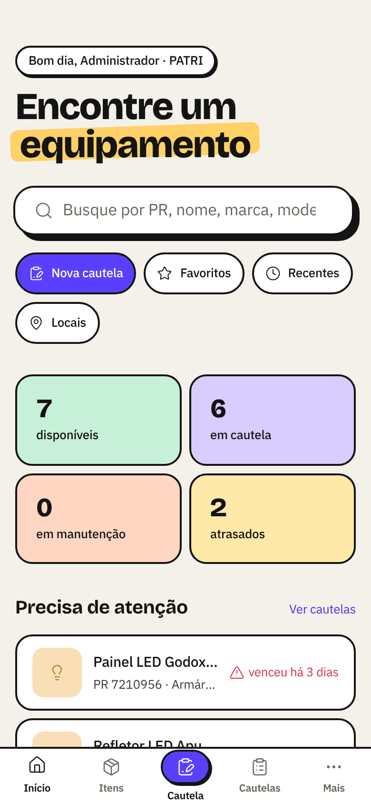 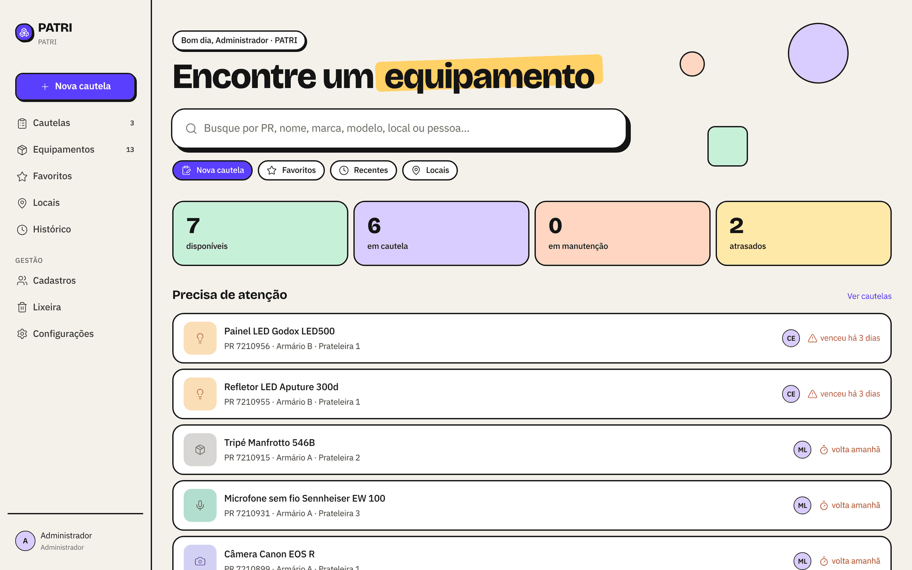

---

## Como rodar uma cópia de demonstração

Siga o [README do repositório](../../README.md#rodar). A cópia começa zerada;
cadastre alguns locais, pessoas e equipamentos fictícios antes de
demonstrar. O sistema do setor nunca é usado em demonstrações.
